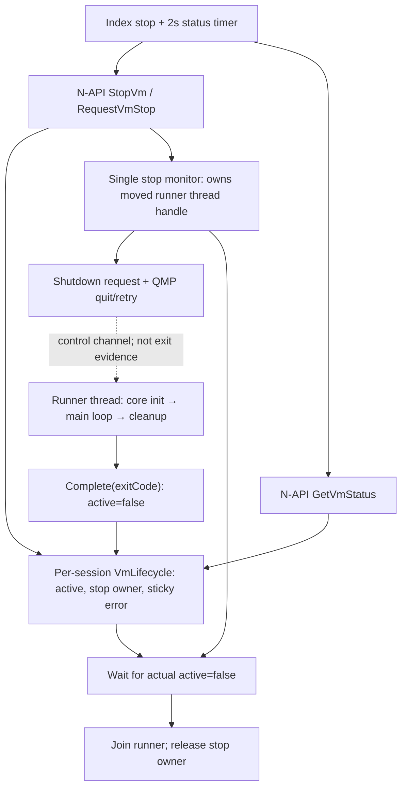

# Embedded fullcore single-run stop boundaries

The shipped path remains QEMU 10.1.93/fullcore with the existing API18 target.
This change applies the instance-ownership and failure-preservation rules found
in Aether App's Phone Supervisor to the current public N-API path. It does not
import that Supervisor's NativeChildProcess, TPM, virtiofs or private UI modules,
and does not enable the optional Phone Core adapter or migrate its ABI.

`StartVm` creates one `VmLifecycle` object and captures it in its actual runner.
`StopVm` calls `RequestVmStop`, which grants at most one background stop owner to
that object. Repeated requests return accepted without moving the runner twice.
The monitor captures no joinable thread during construction; if creation fails,
the original map retains the runner and the next stop request may retry.

A QMP disconnect, guest `shutdown` reply or timeout cannot declare that an
in-process runner has returned. The monitor retries failed QMP quit exchanges
at least one second apart after the five-second grace period. It verifies the
capabilities/quit replies using command IDs and newline framing. When its
twelve-second deadline is observed, it records a sticky failure, keeps the
runtime active/stopping, and continues waiting. A synchronous QMP exchange can
delay that check; this is a diagnostic deadline, not a forced-stop guarantee.
It cannot safely kill an embedded QEMU thread. The runner
alone completes its lifecycle after native/capture/callback cleanup; the monitor
joins its owned thread before releasing the stop-owner reservation.

A startup timeout uses the same stop path. Late `qemu_init` completion cannot
overwrite its stopping state or authorize microphone capture. A zero QEMU exit
does not erase an earlier startup/stop failure. Native `getVmStatus` reports
`stopping` until actual completion, then `failed` or `stopped`; `stopVm=true`
continues to mean that an asynchronous stop request was accepted. Index keeps
`stopping` after acceptance and uses its existing two-second status timer to
observe the native terminal state. Unknown replies and stop errors cannot erase
a terminal state already observed by that timer. Detail/shortcut labels display
the actual status, and the detail start action requires a terminal state.
A naturally returned runner left
joinable in the map blocks another start with a restart-required diagnostic
instead of being overwritten by `std::thread` assignment.



Run the host regression with:

```sh
python -m unittest discover -s tools -p 'test_vm_stop_lifecycle.py' -v
python -m unittest discover -s tools -p 'test_vm_stop_ui.py' -v
```

The suite extracts the actual native stop functions with controlled thread and
platform boundaries, tests thread-creation failure and duplicate stop, exercises
the production watchdog using real host runner threads and join, and tests its
QMP exchange against an isolated Unix socket fixture, with split writes, events,
and explicit error/success replies. It does not guarantee that the OS delivers
each write in a separate receive. The UI test executes the production stop and
status-timer methods with controlled native/manager responses. Native tests
require Linux, Python 3 and g++ with C++17/pthreads; UI tests require Python 3
and Node 22.6+ for TypeScript stripping (CI uses Node 24). These tests do not launch QEMU,
access microphone/NativeWindow/device APIs or load a user's world. Build/CI and
device acceptance must be reported separately.

This is not reentry support. It neither changes Phone `reentrant=0`/consumed
protection nor proves repeated same/different-world startup on fullcore. Startup
readiness still means the existing `qemu_init` result, not guest boot or a first
frame. Partial-initialization cleanup, core global state, actual audio/TPM/VNC
teardown, the existing shutdown-request/cleanup concurrency, loader diagnostics
and real-device single-run acceptance remain
separate work. No `dlclose` or real-core execution is part of these host tests.
